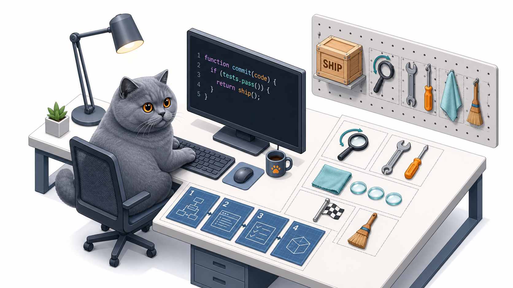

# tgc-skills

<p align="center">
  
</p>

A shipping pipeline for [Claude Code](https://docs.anthropic.com/en/docs/claude-code),
packaged as a plugin. Thirteen skills that take a change from "locked plan" or "list of
bugs" to "merged and cleaned up", using in-session agents and the authenticated GitHub
user. The worker-pane skills also drive Orca, herdr, or cmux when you run inside one.

## The pipeline

```
orchestrate      ─┐
orchestrate-plan ─┼─► checkpoint ──► ship ──► review-loop ──► (you merge) ──► merged
orchestrate-list ─┘                   │           │
                                   polish       review
                                 explain-pr   review-fix
```

| Skill | What it does |
|---|---|
| **orchestrate** | Execute a locked plan too big for one context window: split it into phases, dispatch one fresh subagent per phase, verify each with git plumbing, run independent repos as parallel lanes. |
| **orchestrate-plan** | The same, with visible worker agents in Orca, herdr, or cmux: one fresh worker context per phase, one worktree per lane, and a monitor/unblock loop. Workers never push; the orchestrator ships each lane. |
| **orchestrate-list** | Fan a short list of independent fixes (say, five bugs found in this session) out to one worker and worktree per item, watch and unblock them, verify each lane, and optionally ship one PR per lane. |
| **cmux-orchestrate** | Verified cmux CLI cheat sheet: pane layouts, sending work to workers, reading screens, answering agent prompts in other panes. |
| **herdr-orchestrate** | The same for herdr: panes, tabs, workspaces, worktrees, agent status waits, and answering prompts. |
| **ship** | The pre-merge pipeline: polish the diff, explain it, run the repo's reproducible local gate, commit, push, open a plain-language PR, then run the review loop (or wait for a named reviewer). Never merges. |
| **explain-pr** | Account for every change on the branch before shipping, and flag anything it cannot justify. |
| **review** | Independent review of a PR or branch by parallel Claude reviewers (plus Codex when installed). Reports critical issues only, can review just the changes since the last review, and posts only when asked. |
| **review-loop** | Review → fix → re-review until clean, at most three fix rounds. Re-reviews only what changed, stops when the same finding keeps coming back, commits locally each round, and pushes once. |
| **review-fix** | One pass of the fix cycle: gather every page of PR findings, fix them (small nits only), commit, gate the branch, check the merge for conflicts, push. |
| **polish** | Three parallel review lenses (correctness, simplification, over-engineering) over the diff or a commit range; auto-applies only safe, behavior-preserving findings. |
| **checkpoint** | Mid-flow quick save: cheap verify, one commit, push, keep going. |
| **merged** | Post-merge tail: verify the merge, check that DB migrations actually ran, answer the deploy question, clean up this PR's branch and worktree (Orca-aware), optional release. |

Design principles baked in:

- **One phase per context window.** Fresh subagents re-ground from disk instead of
  inheriting lossy summaries.
- **The orchestrator keeps implementation detail out of its context** — verification is
  git plumbing, narrow greps, and focused read-only agents.
- **Re-review only what changed.** After the first full review, each round reviews the
  new commits and re-checks earlier findings instead of starting over.
- **Merging is always the human's move.** No skill in this repo ever merges a PR.
- **Local gates are reported honestly.** Skills say exactly what ran locally. They do not
  pretend local shell commands reproduce hosted actions, service containers, matrices, or
  external checks.
- **Temporary artifacts stay outside repos.** Worker briefs and loop status files use
  unique paths under the system temporary directory and clean up after themselves.

## Worker panes: Orca, herdr, or cmux

`orchestrate-plan`, `orchestrate-list`, `cmux-orchestrate`, and `herdr-orchestrate` call
one shared script, `scripts/detect-backend.sh`, which prints `herdr`, `orca`, `cmux`, or
`none`. herdr wins when nested, because it runs inside a host terminal and inherits that
terminal's environment. Each skill then loads only the instructions for that backend.
Outside all three, `orchestrate-plan` falls back to `orchestrate`.

## Usage and safety

Plugin skills are namespaced. For example:

```text
/tgc-skills:orchestrate PLAN.md
/tgc-skills:orchestrate-plan PLAN.md
/tgc-skills:orchestrate-list skill=pstack:poteto-mode ship
/tgc-skills:checkpoint
/tgc-skills:ship reviewer octocat
/tgc-skills:review 123
/tgc-skills:review-fix 123
/tgc-skills:merged 123
```

`orchestrate-list`'s `skill=` names any skill each worker should start with, and `ship`
opens one PR per lane. `ship`'s `reviewer <login>` requests that GitHub reviewer and waits
for them instead of running the agent review loop.

`orchestrate`, `orchestrate-plan`, `orchestrate-list`, `checkpoint`, `ship`, `review-fix`,
and `merged` require explicit slash invocation; when one pipeline skill needs another of
these, it reads that skill's file instead of invoking it. `polish`, `explain-pr`,
`review`, and `review-loop` remain composable by the pipeline, but `polish`, `review`,
and `review-loop` proceed only after an explicit request or invocation by an active
parent workflow. No skill merges a PR or force-pushes.

## Install

```
/plugin marketplace add EternallLight/tgc-skills
/plugin install tgc-skills@tgc-skills
```

## Requirements

- Claude Code 2.1.172 or newer — the review workflow relies on nested subagents, which
  landed in that release.
- A Unix-like shell with standard utilities, including `mktemp`.
- `git` 2.38 or newer (for `git merge-tree --write-tree`) and the
  [GitHub CLI](https://cli.github.com/) (`gh`), authenticated.
- Optional: the [Codex CLI](https://github.com/openai/codex) — `review` adds it as an
  extra read-only reviewer when it is installed.
- Optional, for the worker-pane skills: [Orca](https://github.com/stablyai/orca) (then run
  `orca skills install --skill orca-cli --skill orchestration`), herdr, or cmux.
  Everything else runs with in-session agents only.

This plugin targets GitHub repositories. Hosted CI and external checks remain
authoritative when a repository does not expose a reproducible local gate. Pushes and PR
comments come from your authenticated GitHub user.

## License

MIT
